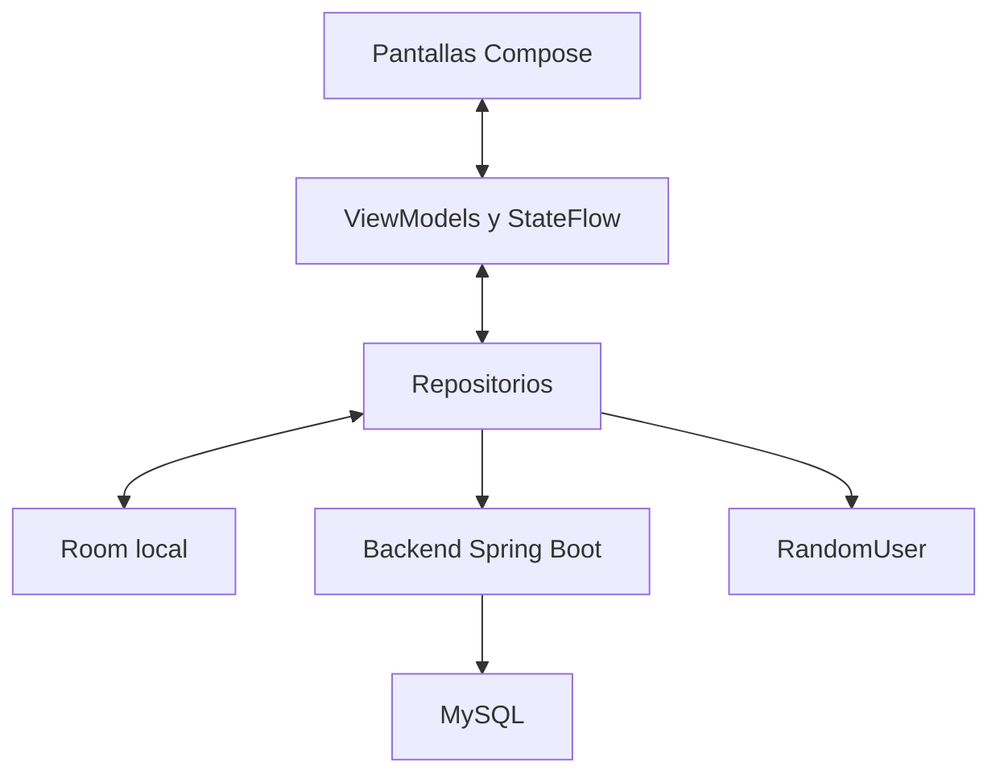

# WIM100 — Aplicación Android

WIM100 es un proyecto académico para registrar y evaluar candidatas del área de ciberseguridad. Reúne sus antecedentes, permite asignar notas mediante una matriz ponderada y entrega a Dirección herramientas para comparar perfiles y resolver candidaturas.

La aplicación se desarrolla sobre la base del equipo con Kotlin, Jetpack Compose y Material 3. Integra un backend Spring Boot con MySQL y mantiene almacenamiento local mediante Room.

| Repositorio | Responsabilidad |
| --- | --- |
| [DesarrolloMovil](https://github.com/DanielEscalanteS/DesarrolloMovil) | Aplicación Android, evaluación, comparación y persistencia local. |
| [wim100-backend](https://github.com/BastianHuenchullan/wim100-backend) | API REST, postulantes, usuarios y validación de credenciales. |

Esta documentación corresponde a la versión integrada de trabajo. Hasta publicar y fusionar sus cambios, la rama principal puede contener una versión anterior.

## Contenido

1. [Objetivo y alcance](#1-objetivo-y-alcance)
2. [Acceso, roles y permisos](#2-acceso-roles-y-permisos)
3. [Pantallas y navegación](#3-pantallas-y-navegación)
4. [Reglas de evaluación y puntajes](#4-reglas-de-evaluación-y-puntajes)
5. [Validaciones del formulario](#5-validaciones-del-formulario)
6. [Arquitectura y organización del código](#6-arquitectura-y-organización-del-código)
7. [Datos, Room y sincronización](#7-datos-room-y-sincronización)
8. [Contrato con el backend](#8-contrato-con-el-backend)
9. [API externa RandomUser](#9-api-externa-randomuser)
10. [Recursos nativos y diseño](#10-recursos-nativos-y-diseño)
11. [Instalación y ejecución](#11-instalación-y-ejecución)
12. [Pruebas automatizadas](#12-pruebas-automatizadas)
13. [Comprobación manual](#13-comprobación-manual)
14. [Solución de problemas](#14-solución-de-problemas)
15. [Alcance actual y pendientes](#15-alcance-actual-y-pendientes)
16. [Trabajo colaborativo](#16-trabajo-colaborativo)

## 1. Objetivo y alcance

La solución facilita una tarea que exigiría consultar antecedentes y comparar notas manualmente. La candidata ingresa sus datos; Evaluadora revisa y evalúa; Dirección consulta resultados y decide. Las ayudas visuales apoyan esa decisión, pero no seleccionan automáticamente a nadie.

Se incluyen postulación pública, login del equipo, gestión de candidaturas, una evaluación local por candidata con edición por su responsable, comparación, resolución e historial local. Los recursos nativos son el manejo del CV en PDF y la autenticación del dispositivo para Dirección.

El campo `area` identifica una especialidad. Actualmente no se administran ofertas, vacantes ni cargos específicos.

| Áreas definidas en `model/Candidata.kt` |
| --- |
| Seguridad ofensiva (Red Team) |
| Seguridad defensiva (Blue Team) |
| Gobierno, riesgo y cumplimiento |
| Ciberseguridad industrial (OT) |
| Forense y respuesta a incidentes |
| Investigación y academia |

## 2. Acceso, roles y permisos

La pantalla inicial ofrece **Soy postulante** y **Administración**:

- Soy postulante abre el formulario sin cuenta ni sesión del equipo.
- Administración abre el login. El servidor devuelve el rol; el usuario no lo elige manualmente.

El enum `Rol` contiene exactamente `EVALUADORA` y `DIRECCION`. La postulación pública no agrega un tercer valor.

| Acción en la app | Postulante sin sesión | Evaluadora | Dirección |
| --- | --- | --- | --- |
| Enviar una nueva postulación | Sí. | Sí. | No desde su panel. |
| Consultar candidatas y antecedentes | No. | Sí. | Sí. |
| Editar o eliminar una candidatura sin resolver | No. | Sí. | No. |
| Crear una evaluación | No. | Sí, si no existe otra y no hay resolución. | No. |
| Editar una evaluación | No. | Solo su responsable, antes de la resolución. | No. |
| Consultar resultados | No. | Sí. | Sí. |
| Comparar y resolver candidaturas | No. | No. | Sí, cumpliendo las reglas. |
| Consultar el historial completo | No. | Sin ruta general desde su panel. | Sí. |

La tabla describe la navegación y las comprobaciones de Android. El backend actual valida el login, pero no emite tokens ni protege cada endpoint por rol.

### Cuentas de demostración

| Usuario | Contraseña | Nombre inicial | Rol |
| --- | --- | --- | --- |
| `evaluadora1` | `wim2026` | Camila Rojas Demo | `EVALUADORA` |
| `evaluadora2` | `wim2026` | Valentina Munoz Demo | `EVALUADORA` |
| `direccion` | `wim2026` | Direccion WIM Demo | `DIRECCION` |

El `DataLoader` del backend crea estas cuentas si la tabla de usuarios está vacía. No restablece sus contraseñas en cada inicio.

Dirección completa el login y después la verificación del dispositivo. Cancelarla no abre su sesión. La sesión permanece en memoria; no se implementa inicio automático tras cerrar el proceso.

## 3. Pantallas y navegación

Los archivos siguientes están en `app/src/main/java/com/example/wim100/`.

| Pantalla | Archivo en `ui/screens/` | Función |
| --- | --- | --- |
| Inicio | `InicioScreen.kt` | Elegir entre postular y entrar al equipo. |
| Login | `LoginScreen.kt` | Credenciales, errores y verificación para Dirección. |
| Formulario | `PostulacionScreen.kt` | Alta pública, registro por Evaluadora y edición de antecedentes. |
| Listado | `CandidatasScreen.kt` | Candidatas, filtro por estado, refresco y acciones. |
| Antecedentes | `DetallePostulacionScreen.kt` | Datos personales, experiencia, LinkedIn y CV. |
| Evaluación | `EvaluacionScreen.kt` | Notas, justificaciones, cálculo, guardado y edición. |
| Detalle de evaluación | `DetalleEvaluacionesScreen.kt` | Responsable, notas, observaciones y resumen visual. |
| Dirección | `DireccionScreen.kt` | Ranking, filtros, ordenamiento, comparación y resoluciones. |
| Comparación | `ComparacionScreen.kt` | Contrastar candidatas elegidas por total y criterio. |
| Historial | `HistorialScreen.kt` | Acciones locales con usuario y fecha. |

### Recorridos principales

**Postulante:** Inicio → Soy postulante → Enviar mi postulación → completar antecedentes y adjuntar PDF → enviar → recibir ID → Finalizar → Inicio. `registradaPor` utiliza el nombre ingresado. No existe seguimiento o edición pública después del envío.

**Evaluadora:** Administración → login → refrescar candidatas → consultar antecedentes → registrar, editar o eliminar cuando corresponda → evaluar → consultar resultados. En un alta del equipo, `registradaPor` usa el nombre recibido en la sesión. Al editar se conserva el responsable original.

**Dirección:** Administración → login → verificación del dispositivo → refrescar → revisar ranking → filtrar u ordenar → consultar antecedentes y evaluación → comparar candidatas → seleccionar o rechazar → consultar historial.

### Rutas

`WimApp.kt` prepara dependencias y elige la navegación según exista una sesión. `AccesoNavHost`, definido en `navigation/WimNavHost.kt`, contiene el recorrido público; `WimNavHost` contiene las pantallas del equipo. Las constantes están en `navigation/Rutas.kt`.

| Ruta | Acceso |
| --- | --- |
| `inicio` | Público. |
| `login` | Público, para entrar al equipo. |
| `candidata/nueva` | Público o Evaluadora, en navegaciones separadas. |
| `candidatas` | Evaluadora. |
| `candidata/{candidataId}` | Evaluadora y Dirección. |
| `candidata/{candidataId}/editar` | Evaluadora. |
| `evaluacion/{candidataId}` | Evaluadora. |
| `direccion` | Dirección. |
| `historial` | Dirección. |
| `detalle-evaluaciones/{candidataId}` | Evaluadora y Dirección. |
| `comparar/{ids}` | Dirección; IDs separados por comas. |

Cerrar sesión retira la navegación del equipo. Atrás no debe permitir volver a ella sin login.

## 4. Reglas de evaluación y puntajes

### Unicidad, responsable y edición

- Se admite una evaluación por candidata en Room, independientemente de la evaluadora. El repositorio y un índice único sobre `candidataId` evitan duplicados locales.
- La responsable se identifica por su nombre normalizado: minúsculas, extremos recortados y sin espacios repetidos.
- Otra evaluadora puede consultar la evaluación, pero no editarla.
- La edición conserva ID y fecha originales; agrega fecha de edición e incrementa `revision`.
- Una revisión desactualizada exige volver a abrir la evaluación.
- Una candidatura seleccionada o no seleccionada bloquea nuevas evaluaciones y la modificación de su evaluación.

Estas reglas se aplican a la base local. No existe unicidad global entre dispositivos porque sus evaluaciones todavía no se almacenan en el backend.

### Matriz académica configurada

Se define en `model/CriteriosDemostracion.kt`. No hay una pantalla para editar la matriz en esta versión.

| Criterio | Descripción | Peso |
| --- | --- | --- |
| Trayectoria | Años y relevancia de experiencia. | 25 % |
| Conocimientos | Certificaciones y educación. | 25 % |
| Liderazgo | Habilidades de gestión y equipo. | 20 % |
| Visión | Perspectiva estratégica en ciberseguridad. | 15 % |
| Comunicación | Claridad en la entrega de ideas. | 15 % |
| **Total** | | **100 %** |

Cada criterio recibe una nota entera de **1 a 5**. El peso indica cuánto influye en el total. `CalculadoraPuntaje.calcular` utiliza:

```text
Puntaje total = 100 × suma(nota × peso) / (5 × suma(pesos))
```

| Todas las notas en | Resultado |
| --- | --- |
| 5 | 100 puntos. |
| 4 | 80 puntos. |
| 3 | 60 puntos. |
| 1 | 20 puntos. |

Las notas faltantes aportan cero al cálculo visual durante el llenado. No se guarda una evaluación completa hasta asignar todas las notas.

### Validaciones y ayudas visuales

- Nota: entero entre 1 y 5.
- Nota 1 o 2: justificación de al menos 10 caracteres.
- Observación por criterio: máximo 300 caracteres.
- Observación general: entre 20 y 400 caracteres.

| Puntaje total | Categoría |
| --- | --- |
| Desde 85 | Sobresaliente. |
| Desde 70 y menor que 85 | Sólida. |
| Desde 50 y menor que 70 | En desarrollo. |
| Mayor que 0 y menor que 50 | Inicial. |
| 0 | Sin puntaje. |

Las notas 4 o 5 aparecen como **Fortalezas**, la nota 3 como **Nivel adecuado**, y las notas 1 o 2 como **Por mejorar**. Los grupos vacíos se ocultan. Se muestran indicadores de progreso, etiquetas y observaciones para explicar los números.

### Comparación y ordenamiento

Dirección elige manualmente dos o tres candidatas diferentes, de la misma área y con una evaluación única disponible. Puede abrir sus evaluaciones completas y comparar totales, notas y perfiles identificados.

El listado se ordena por puntaje general o por criterio, en ambos sentidos. Los registros sin nota quedan al final. Los empates se ordenan por nombre y luego por ID; ese orden no implica una preferencia de selección.

### Estados y resolución

Los valores JSON coinciden exactamente con `EstadoCandidatura` en Android y `EstadoPostulante` en el backend.

| Estado | Significado |
| --- | --- |
| `POSTULADA` | Candidatura registrada. |
| `EN_EVALUACION` | Estado disponible en el contrato para una evaluación en proceso. |
| `EVALUADA` | Evaluación completa en el flujo de la app. |
| `SELECCIONADA` | Resolución favorable. |
| `NO_SELECCIONADA` | Resolución de no selección. |

Abrir la evaluación no envía automáticamente `EN_EVALUACION`. Guardar una evaluación completa registra las notas en Room y sincroniza `EVALUADA` con el backend.

Para resolver desde Dirección se exige refresco correcto, estado `EVALUADA`, evaluación local disponible y ausencia de resolución previa. Se envía el estado al servidor y se registra la acción localmente. No existe un puntaje mínimo automático para seleccionar.

## 5. Validaciones del formulario

| Campo | Regla de Android | Regla adicional relevante del backend |
| --- | --- | --- |
| Nombre | Obligatorio; mínimo 3 caracteres tras recortar extremos. | Entre 3 y 60 caracteres. |
| Correo | Formato válido y dominio `example.com` o `ejemplo.cl`. | Correo único sin distinguir mayúsculas. |
| Teléfono | Entre 8 y 15 dígitos; admite espacios, `+`, guiones y paréntesis. | Obligatorio; máximo 20 caracteres en total. |
| Área | Selección obligatoria. | Texto obligatorio. |
| Años | Entero mayor o igual a cero. | Máximo 50. |
| Resumen | Mínimo 30 caracteres tras recortar extremos. | Entre 30 y 500 caracteres. |
| LinkedIn | Perfil con `https://linkedin.com/in/...` o `https://www.linkedin.com/in/...`. | Obligatorio y comienza con `https://`. |
| CV | PDF obligatorio al crear, hasta 5 MB. | Recibe solo `cvNombre`, que puede ser nulo. |

Las validaciones están en `validation/FormularioValidator.kt`, `CandidataValidator.kt` y `EvaluacionValidator.kt`. No son idénticas a las del servidor: un dato aceptado por Android todavía puede producir `400`; la app presenta el mensaje recibido.

Los errores se actualizan al corregir los campos después de un intento de validación. Un correo duplicado (`409`) se señala junto al campo. Durante el envío se evita el doble toque. Los fallos de red conservan los datos para reintentar.

En edición puede conservarse el CV previo aunque no esté físicamente en ese teléfono o no se conozca su tamaño. Si se reemplaza, se valida el nuevo PDF.

## 6. Arquitectura y organización del código

Se utiliza **MVVM** con repositorios. La pantalla observa estado y envía acciones al ViewModel; no hace peticiones Retrofit directamente.



Las rutas siguientes parten de `app/src/main/java/com/example/wim100/`.

| Carpeta | Responsabilidad |
| --- | --- |
| `ui/screens/` | Pantallas y eventos del usuario. |
| `ui/components/` | Campos, filtros, selectores, contenedores y resultados reutilizables. |
| `ui/theme/` | Tema Material 3, colores y tipografía. |
| `viewmodel/` | Lógica de presentación y estados. |
| `ui/viewmodel/` | Alias de compatibilidad de la fábrica y sesión. |
| `model/` | Entidades, roles, estados, matriz, cálculo y análisis. |
| `validation/` | Validadores. |
| `data/local/` | Room, migración, conversores y relaciones. |
| `data/local/dao/` | Consultas y operaciones locales. |
| `data/remote/` | DTOs, Retrofit, mapeo y errores. |
| `data/repository/` | Acceso a datos remotos y locales. |
| `di/` | Contenedor activo de dependencias. |
| `navigation/` | Rutas y navegación pública y del equipo. |
| `nativo/` | PDF y autenticación del dispositivo. |

| Archivo de conexión | Función |
| --- | --- |
| `MainActivity.kt` | Entrada Android; Compose y permiso de red local en API 37 o superior. |
| `WimApplication.kt` | Mantiene el contenedor de la app. |
| `di/AppContainer.kt` | Crea Room y repositorios, incluyendo Auth y RandomUser. |
| `ui/WimApp.kt` | Prepara la fábrica y elige la navegación según sesión. |
| `viewmodel/AppViewModelFactory.kt` | Crea ViewModels con sus repositorios. |
| `navigation/WimNavHost.kt` | Conecta los recorridos. |

El `AppContainer.kt` del paquete raíz permanece de la base anterior; el activo es `di/AppContainer.kt`, referenciado explícitamente por `WimApplication`. Los alias de `ui/viewmodel/` reutilizan las implementaciones funcionales de `viewmodel/`.

### ViewModels principales

| Archivo en `viewmodel/` | Responsabilidad |
| --- | --- |
| `SesionViewModel.kt` | Credenciales, login, sesión pendiente de biometría y cierre. |
| `FormularioViewModel.kt` y `FormularioUiState.kt` | Datos del formulario, validación, alta, edición, nombre de ejemplo y confirmación. |
| `CandidatasViewModel.kt` | Listado observable, evaluaciones asociadas, refresco y error de sincronización. |
| `DetalleCandidataViewModel.kt` | Observación de una candidata y eliminación con comprobación de rol y estado. |
| `EvaluacionViewModel.kt` | Precarga de notas, validación, guardado o edición y reintento del estado remoto. |
| `DireccionViewModel.kt` | Ranking, filtros, ordenamiento, selección para comparar y resolución. |
| `DetalleEvaluacionesViewModel.kt` | Consulta reactiva de la ficha y sus criterios. |
| `ComparacionViewModel.kt` | Validación de la selección y preparación de los perfiles comparados. |
| `HistorialViewModel.kt` | Consulta reactiva de acciones registradas. |
| `DatosEjemploViewModel.kt` | Soporte conservado de ejemplos locales; sin ruta en el recorrido normal actual. |

### Estado y operaciones asíncronas

Los DAOs emiten `Flow` al cambiar los datos. Los ViewModels lo combinan con estados de carga, guardado y error y exponen `StateFlow`. Compose los observa con `collectAsStateWithLifecycle`.

`StateFlow` conserva el último estado mientras vive el ViewModel. No representa un borrador permanente: no hay recuperación del formulario después de la muerte del proceso. Las operaciones asíncronas usan coroutines y `viewModelScope`.

## 7. Datos, Room y sincronización

| Información | Almacenamiento actual | Entre dispositivos |
| --- | --- | --- |
| Usuarios y contraseñas BCrypt | MySQL del backend. | Login contra el mismo servidor. |
| Postulantes y estado | MySQL y copia sincronizada en Room. | Se consultan al refrescar. |
| Criterios | Room, inicializados con la matriz de la app. | No se descargan del backend. |
| Evaluaciones y notas | Room. | No se comparten. |
| Historial | Room. | No se comparte. |
| PDF y `cvUri` | Archivos privados y referencia local en Room. | No se comparten. |
| `cvNombre` | Backend y copia local. | Se comparte el nombre, no el archivo. |
| Sesión | Memoria del ViewModel. | No se comparte. |

La base `wim100.db` está en versión **2**. Sus tablas son `candidatas`, `criterios`, `evaluaciones`, `puntajes_criterio` e `historial`. Una evaluación pertenece a una candidata; las notas pertenecen a la evaluación y a sus criterios. El borrado de una candidata elimina sus evaluaciones y notas por cascada. El historial tiene índice de candidata, pero no una llave foránea con ese borrado en cascada.

### Métodos remotos utilizados

| Método de `CandidataRepository` | Operación |
| --- | --- |
| `sincronizarDesdeServidor()` | Listar y actualizar la copia local. |
| `registrarEnServidor()` | Alta remota y copia local con ID devuelto. |
| `actualizarEnServidor()` | Edición remota y actualización local. |
| `eliminarEnServidor()` | Eliminación remota y después local. |
| `cambiarEstadoEnServidor()` | Cambio remoto de estado y actualización local. |

El DAO utiliza `@Upsert` para actualizar respuestas remotas sin reemplazar destructivamente la candidata y eliminar evaluaciones por cascada. El mapeo conserva `cvUri` local y nunca lo envía al backend.

Si falla el refresco, se conserva el listado local y se informa el error. Las pantallas bloquean las acciones que exigen un refresco correcto según su flujo. No existe una cola general de operaciones sin conexión.

Una evaluación se guarda primero en una transacción local. Después se sincroniza su estado. Si falla ese envío, la pantalla permite reintentarlo sin registrar otra evaluación. Ese indicador está en memoria: no es una cola persistente que se ejecute automáticamente al reiniciar.

### Migración y ejemplos

`Migraciones.MIGRATION_1_2` adapta la base anterior a una evaluación por candidata. Registra los detalles de evaluaciones adicionales en el historial antes de retirarlas, conserva la de menor ID, agrega los campos de revisión y el índice único.

`DatosSemilla` prepara criterios si no existen. `DatosEjemploRepository` y su ViewModel permanecen como soporte de ejemplos y pruebas locales; no hay un botón para cargar esos datos en la navegación normal de esta integración.

El `DataLoader` remoto crea tres candidatas cuando la tabla está vacía:

| Nombre | Área |
| --- | --- |
| Ignacia Valdes Soto | Seguridad ofensiva (Red Team). |
| Martina Herrera Lagos | Seguridad defensiva (Blue Team). |
| Fernanda Castillo Rivas | Gobierno, riesgo y cumplimiento. |

Estas candidatas no tienen notas locales ni PDF descargable; solo nombre de CV. Como pertenecen a áreas distintas, se necesitan dos registros evaluados de la misma área para demostrar la comparación.

## 8. Contrato con el backend

Retrofit y Gson se configuran en `data/remote/RetrofitClient.kt`. `WimApi.kt` define peticiones, `Dtos.kt` define sus datos y `PostulanteMapper.kt` convierte entre DTO y entidad local.

| Entorno | Dirección |
| --- | --- |
| Computador | `http://localhost:8080/api/` |
| Android Emulator | `http://10.0.2.2:8080/api/` |
| Teléfono físico | `http://IP_DEL_COMPUTADOR:8080/api/` |
| RandomUser | `https://randomuser.me/` |

`WIM_BASE_URL` debe conservar su barra final. `localhost` dentro del emulador o teléfono no representa al computador del backend.

### Operaciones HTTP

| Método | Endpoint | Respuestas principales |
| --- | --- | --- |
| GET | `/api/postulantes` | 200, listado por fecha de registro descendente. |
| GET | `/api/postulantes/{id}` | 200 o 404. |
| POST | `/api/postulantes` | 201, 400 o 409 por correo duplicado. |
| PUT | `/api/postulantes/{id}` | 200, 400, 404 o 409. |
| PATCH | `/api/postulantes/{id}/estado` | 200, 400 por cuerpo inválido o 404. |
| DELETE | `/api/postulantes/{id}` | 204 sin cuerpo, o 404. |
| POST | `/api/auth/login` | 200, 400 por campos vacíos o 401 por credenciales incorrectas. |

Son siete operaciones HTTP. La colección Postman del backend tiene nueve solicitudes porque incluye escenarios de error.

### Campos de `PostulanteDto`

| Campo | Tipo Android | Significado |
| --- | --- | --- |
| `id` | `Long` | Identificador del backend. |
| `nombre` | `String` | Nombre de la candidata. |
| `correo` | `String` | Correo único. |
| `telefono` | `String` | Contacto. |
| `area` | `String` | Especialidad. |
| `aniosExperiencia` | `Int` | Años de experiencia. |
| `resumenExperiencia` | `String` | Antecedentes profesionales. |
| `linkedinUrl` | `String` | Enlace ingresado manualmente. |
| `cvNombre` | `String?` | Nombre del PDF. |
| `estado` | `String` | Valor exacto del enum. |
| `fechaRegistro` | `Long` | Milisegundos desde epoch. |
| `registradaPor` | `String` | Nombre de quien registra. |

`PostulanteRequest` incluye los antecedentes y `registradaPor`, pero no `id`, `estado`, `fechaRegistro` ni `cvUri`. El backend genera ID, estado inicial y fecha al crear; conserva estado, fecha y responsable al editar antecedentes.

Login:

```json
{"usuario": "evaluadora1", "password": "wim2026"}
```

La respuesta contiene `id`, `usuario`, `nombre` y `rol`, sin token. Cambio de estado:

```json
{"estado": "EVALUADA"}
```

`Errores.kt` interpreta `status`, `mensaje` y `errores` del servidor; si no puede leer ese formato, usa el código HTTP o un mensaje de conexión. El contrato no incluye endpoints de notas, criterios, historial o archivos. LinkedIn se guarda como enlace: no se extrae su perfil.

## 9. API externa RandomUser

```http
GET https://randomuser.me/api/?gender=female&nat=es&inc=name
```

| Parámetro | Uso |
| --- | --- |
| `gender=female` | Perfiles femeninos de ejemplo. |
| `nat=es` | Nacionalidad española para los datos de ejemplo. |
| `inc=name` | Solicitar únicamente el nombre. |

`RandomUserApi` recibe la respuesta y `RandomUserRepository` combina `name.first` y `name.last`. `FormularioViewModel` actualiza solo el nombre.

**Usar nombre de ejemplo** está disponible en el formulario de Evaluadora para la demostración. No aparece en el formulario público ni guarda automáticamente una candidatura. Si falla, se puede escribir el nombre manualmente sin alterar los demás campos.

## 10. Recursos nativos y diseño

### CV en PDF

`ArchivoPostulacion.importar` utiliza `ActivityResultContracts.OpenDocument`, copia el documento a `filesDir/cvs/` con nombre interno único y valida extensión `.pdf`, tamaño mayor que cero y hasta `5 × 1024 × 1024` bytes. `PdfRenderer` comprueba su lectura y que tenga páginas. Si falla, se elimina la copia incompleta.

La apertura o envío a una aplicación compatible usa `FileProvider` y permiso temporal de lectura. Se necesita un visor compatible. El servidor recibe `cvNombre`; el archivo y `cvUri` se quedan en ese dispositivo. Un CV registrado desde otro teléfono puede mostrar su nombre sin archivo local disponible.

### Autenticación del dispositivo

`MainActivity` extiende `FragmentActivity` para utilizar `BiometricPrompt`. `BiometriaHelper` admite biometría o credencial compatible en API 30 o superior; en API inferiores utiliza biometría compatible configurada.

La verificación es adicional al login de Dirección. Si falta configuración, se puede abrir Seguridad desde el login. Comprueba la autenticación del dispositivo; no reemplaza las credenciales de la cuenta del servidor.

### Permisos

| Declaración | Uso |
| --- | --- |
| `INTERNET` | Backend y RandomUser. |
| `USE_BIOMETRIC` | Verificación de Dirección. |
| `ACCESS_LOCAL_NETWORK` | Solicitado por el código en API 37 o superior para conectarse al servidor local. |
| `usesCleartextTraffic="true"` | HTTP al backend de desarrollo. |

El selector de documentos y el almacenamiento privado evitan requerir acceso general a archivos para este flujo.

### Material 3, adaptación y animaciones

Se utilizan tarjetas, campos con errores, confirmaciones y estados de carga. `WIM100Theme` adapta el tema claro u oscuro y colores dinámicos en versiones compatibles. `PantallaDesplazable` y los contenedores con desplazamiento facilitan el uso en horizontal y con teclado.

El formulario usa `AnimatedVisibility` y `AnimatedContent`. Los resultados animan sus indicadores mediante `animateFloatAsState` en `ResultadosEvaluacion.kt`. Los colores acompañan etiquetas y notas, en lugar de ser la única forma de interpretar resultados.

## 11. Instalación y ejecución

### Configuración técnica

| Componente | Valor del repositorio |
| --- | --- |
| Android Gradle Plugin / Gradle Wrapper | 9.2.1 / 9.4.1. |
| JDK para ejecutar Gradle | 21, solicitado por su configuración del daemon. |
| Compatibilidad Java del módulo | Java 11, distinta del JDK que ejecuta Gradle. |
| Plugin Compose Kotlin / Compose BOM | 2.2.10 / 2026.02.01. |
| Room / Navigation Compose | 2.8.4 / 2.9.8. |
| Retrofit / OkHttp | 2.11.0 / 4.12.0. |
| JUnit / MockK | 4.13.2 / 1.14.7. |
| compileSdk / targetSdk / minSdk | 37 / 37 / 24. |

Las versiones se definen en `gradle/libs.versions.toml`. Utilizar Android Studio compatible con el AGP del proyecto, JDK 21 para Gradle y el SDK requerido. El backend utiliza su propia configuración Java 17.

### Primero, levantar el backend

1. Abrir `wim100-backend`, donde está `pom.xml`.
2. Iniciar MySQL local, o seguir la alternativa Docker de su README.
3. Para ejecución local, comprobar `src/main/resources/application.properties`: puerto MySQL 3306, base `wim100`, usuario `root` y contraseña vacía. Ajustar si el entorno es distinto.
4. En PowerShell, desde la raíz del backend:

```powershell
java -version
.\mvnw.cmd spring-boot:run
```

En Linux o macOS: `bash ./mvnw spring-boot:run`. El backend escucha en 8080. Comprobar desde el computador:

```powershell
Invoke-RestMethod -Method Get -Uri "http://localhost:8080/api/postulantes"
```

### Después, abrir Android

Si todavía no se tiene el proyecto:

```powershell
git clone https://github.com/DanielEscalanteS/DesarrolloMovil.git
cd DesarrolloMovil
```

1. Utilizar la rama que contenga la integración del equipo. La rama de trabajo de esta integración es `feature/ui-viewmodels-api`; conservar cambios locales antes de cambiar de rama.
2. Abrir en Android Studio la raíz con `settings.gradle.kts`, `gradlew.bat` y `app`. No abrir solo `app` ni el repositorio del backend.
3. Sincronizar y seleccionar JDK 21 para Gradle.
4. Instalar Android SDK 37 y seleccionar un emulador compatible.
5. Verificar `WIM_BASE_URL` en `RetrofitClient.kt`.
6. Ejecutar desde la raíz:

```powershell
.\gradlew.bat :app:testDebugUnitTest :app:assembleDebug
```

En Linux o macOS:

```bash
bash ./gradlew :app:testDebugUnitTest :app:assembleDebug
```

7. Ejecutar el módulo `app` con su actividad predeterminada.
8. En API 37 o superior, conceder acceso a la red local cuando se solicite.

El APK debug se genera en `app/build/outputs/apk/debug/app-debug.apk`. No equivale al release firmado de entrega.

### Teléfono físico

Cambiar `WIM_BASE_URL` por la IP del computador conservando `:8080/api/`, y compilar de nuevo. Los dispositivos deben poder comunicarse por la red y el puerto 8080 debe estar permitido en el computador.

## 12. Pruebas automatizadas

En la verificación del **21 de noviembre de 2026**, `:app:testDebugUnitTest` y `:app:assembleDebug` finalizaron correctamente: **79 pruebas unitarias, cero fallos, cero errores y cero omitidas**. Se conservaron 35 anteriores y se agregaron 44 en los seis archivos de integración de ViewModels.

| Archivo en `app/src/test/java/com/example/wim100/` | Casos | Alcance |
| --- | --- | --- |
| `viewmodel/SesionViewModelTest.kt` | 11 | Login, errores, biometría pendiente y sesión. |
| `viewmodel/CandidatasViewModelTest.kt` | 3 | Refresco y conservación del listado ante errores. |
| `viewmodel/FormularioRemotoViewModelTest.kt` | 15 | Alta, edición, duplicados, errores de red, RandomUser y postulación pública. |
| `viewmodel/DetalleCandidataViewModelTest.kt` | 6 | Consulta, permisos y eliminación. |
| `viewmodel/EvaluacionSincronizacionTest.kt` | 4 | Estado remoto y reintentos sin duplicación. |
| `viewmodel/DireccionResolucionTest.kt` | 5 | Condiciones y errores de resolución. |
| `viewmodel/FormularioValidatorTest.kt` | 12 | Validación de datos personales. |
| `viewmodel/FormularioViewModelTest.kt` | 11 | Estado del formulario y corrección de errores. |
| `validation/CandidataValidatorCvTest.kt` | 8 | Nombre, extensión y tamaño del CV. |
| `ComparacionCandidatasTest.kt` | 3 | Comparación, lectura de resultados y ordenamiento. |
| `ExampleUnitTest.kt` | 1 | Prueba básica conservada; no valida una funcionalidad de negocio. |
| **Total** | **79** | |

MockK simula dependencias. `kotlinx-coroutines-test` controla `Dispatchers.Main`. Estas pruebas no demuestran por sí solas comunicación real con MySQL, presentación visual ni biometría física.

Reportes: `app/build/reports/tests/testDebugUnitTest/index.html` y `app/build/test-results/testDebugUnitTest/`. Volver a ejecutar después de modificar código. En el entorno aislado se precargó Byte Buddy con un script temporal para permitir MockK; ese ajuste no se agregó a las dependencias del proyecto.

### Pruebas instrumentadas existentes

En `app/src/androidTest/java/com/example/wim100/` están `PostulacionRoomTest.kt`, `ConsultaEvaluacionesRoomTest.kt`, `MigracionRoomTest.kt` y `ExampleInstrumentedTest.kt`. Comprueban operaciones locales, consulta y edición de evaluaciones, migración y aspectos que necesitan Android.

```powershell
.\gradlew.bat :app:connectedDebugAndroidTest
```

Requieren emulador o dispositivo. No forman parte de las 79 pruebas y no se ejecutaron en el entorno de validación de esta integración. Las comprobaciones manuales tampoco equivalen a pruebas automáticas de Compose.

### Cobertura

Los casos aprobados no acreditan un porcentaje de cobertura. Para evaluar la meta del 80 %, generar un reporte con una herramienta compatible y revisar los paquetes exigidos por la pauta. Esa medición sigue pendiente en la verificación documentada.

## 13. Comprobación manual

Usar **la misma instalación** para evaluar y consultar desde Dirección: las notas son locales. Mantener backend y MySQL activos salvo al probar desconexiones.

| Caso | Acción y resultado esperado |
| --- | --- |
| Inicio | Sin sesión, mostrar Soy postulante y Administración. |
| Acceso público | Abrir formulario sin login ni generador de nombres. |
| Validación | Enviar vacío, corregir y comprobar que desaparecen los errores y permite enviar. |
| PDF | Rechazar archivo vacío, dañado o mayor de 5 MB; permitir seleccionar otro. |
| Alta | Enviar datos válidos, recibir ID y volver al inicio con Finalizar. |
| Refresco | Entrar como Evaluadora y ver el registro una sola vez. |
| Nombre de ejemplo | Desde Nueva candidata de Evaluadora, cambiar únicamente el nombre. |
| Login inválido | Contraseña incorrecta informa error sin abrir sesión. |
| CV local | Abrir el archivo adjuntado en la misma instalación con un visor compatible. |
| Edición | Cambiar antecedentes y conservar ID, fecha y responsable originales. |
| Duplicado | Mostrar error de correo existente y permitir corregirlo para enviar. |
| Evaluación incompleta | Impedir guardar sin notas o sin justificar una nota baja. |
| Puntaje | Todas las notas en 4 y observación válida producen 80 puntos. |
| Edición de notas | La responsable edita el mismo registro; aumenta la revisión. |
| Otra evaluadora | No crear una segunda evaluación ni editar la ajena. |
| Dirección | Cancelar verificación impide entrar; completarla abre el panel. |
| Comparación | Elegir dos evaluadas de la misma área; mostrar resultados identificados. |
| Área distinta | No incorporar una candidata de otra área a la misma comparación. |
| Orden | Comprobar general o criterio y ambos sentidos. |
| Resolución | Confirmar selección o rechazo, consultar estado e historial y bloquear edición de notas. |
| Eliminación | Cancelar no cambia datos; confirmar elimina una candidata de prueba sin resolver. |
| Desconexión | Informar error y conservar datos escritos; permitir reintentar al recuperar backend. |
| Persistencia | Reabrir y conservar registros guardados; el equipo vuelve a iniciar sesión. |
| Cierre de sesión | Atrás no permite volver a pantallas del equipo. |
| Presentación | Rotar y abrir teclado sin perder acceso a contenido, errores o botones. |

### Datos para un recorrido completo

Registrar dos candidatas con PDF de prueba. Cambiar los números del correo si ya existen.

| Campo | Candidata A | Candidata B |
| --- | --- | --- |
| Nombre | Ana Prueba | Beatriz Prueba |
| Correo | ana.prueba01@example.com | beatriz.prueba01@example.com |
| Teléfono | +56912345678 | +56912345679 |
| Área | Seguridad defensiva (Blue Team) | Seguridad defensiva (Blue Team) |
| Años | 3 | 5 |
| Resumen | Tengo experiencia en monitoreo de seguridad y análisis de incidentes informáticos. | Tengo experiencia en respuesta a incidentes y coordinación de equipos de ciberseguridad. |
| LinkedIn | https://www.linkedin.com/in/ana-prueba | https://www.linkedin.com/in/beatriz-prueba |

Asignar inicialmente todas las notas en 4 a Ana y en 5 a Beatriz, con observaciones generales válidas: deben producir 80 y 100. Después usar notas variadas para demostrar las ayudas visuales, justificando las bajas.

El equipo informó que completó satisfactoriamente los bloques manuales y casos adicionales durante esta revisión. Para la entrega formal, conservar la evidencia solicitada por la pauta; este README no incluye capturas o grabaciones de esos recorridos.

## 14. Solución de problemas

| Síntoma | Revisar |
| --- | --- |
| No conecta | Backend, MySQL, `10.0.2.2`, puerto 8080 y permiso de red local cuando corresponda. |
| Solo falla en teléfono físico | IP del computador, conectividad, puerto y recompilación tras cambiar la URL. |
| Credenciales rechazadas | Cuentas del DataLoader y tabla usuarios actual; las cuentas existentes no se restablecen. |
| Dirección bloqueada | Credenciales y huella o bloqueo compatible configurado. |
| Correo rechazado | Formato, dominio ficticio admitido y duplicados. |
| PDF de ejemplo ausente | El servidor solo tiene su nombre; probar con un archivo adjuntado en esa instalación. |
| Otro dispositivo no muestra notas | Las evaluaciones e historial son locales. |
| Conflicto de ID o correo | Comparar datos locales y remotos, especialmente después de ejemplos antiguos. |
| No permite resolver | Refrescar y comprobar estado EVALUADA y evaluación local disponible. |
| Evaluación guardada sin sincronizar | Reintentar el estado desde la pantalla, sin crear otra evaluación. |
| Actividad inexistente al ejecutar | Sincronizar y usar actividad predeterminada del módulo app. La actividad es `com.example.wim100.MainActivity` y el applicationId es `com.example.appsemestral`: son identificadores diferentes y válidos. |

Antes de reinstalar o borrar datos, considerar que notas, historial y PDF locales no se recuperan desde MySQL.

## 15. Alcance actual y pendientes

La versión permite completar el recorrido académico en un dispositivo. Sus límites actuales son:

- Evaluaciones e historial locales, sin endpoints para compartir detalles. Un estado remoto EVALUADA no entrega las notas a otro teléfono.
- Login con BCrypt, pero sin tokens ni autorización por rol en el CRUD remoto. Las reglas de resolución se verifican en Android.
- Sin carga o descarga remota de PDF; se comparte únicamente su nombre.
- El refresco incorpora y actualiza, pero no retira automáticamente los registros borrados por otro cliente.
- Diferencias de ID y correo detienen el refresco. Un correo cambiado desde otro cliente puede activar este control.
- Sin transacción distribuida entre backend, copia local e historial: una operación remota podría completarse antes de fallar el paso local. Revisar el servidor antes de repetir un alta dudosa.
- Sin cola persistente de reintentos, sincronización automática de notas ni recuperación de borradores tras cerrar el proceso.
- Algunos límites máximos de validación existen solo en el backend.
- La validación documentada acredita APK debug y pruebas unitarias, no APK release firmado ni 80 % de cobertura.

Son límites de lo implementado, no funcionalidades ya desarrolladas. HTTP local y cuentas públicas se utilizan para la demostración académica.

## 16. Trabajo colaborativo

Integrantes:

- [BastianHuenchullan](https://github.com/BastianHuenchullan).
- [DanielEscalanteS](https://github.com/DanielEscalanteS).
- [JojitaGamerHD](https://github.com/JojitaGamerHD).

Se trabaja por ramas, con commits en español y pull requests hacia `main`. La integración conserva la base del equipo y añade las conexiones necesarias. Cada funcionalidad debe acompañarse de sus pruebas; navegación y fábrica de ViewModels requieren coordinación por ser archivos compartidos.

Al publicar, incluir código, pruebas y README. Los ZIP de intercambio, reportes locales, `local.properties`, compilaciones y credenciales privadas no forman parte del cambio de código. La firma final del APK se coordina con su responsable.

**Última revisión:** 21 de noviembre de 2026. Integración Android de trabajo y backend `main` en `6ca31d3c14eb1cd744a46b6bb4bafb314420cdb6`.
