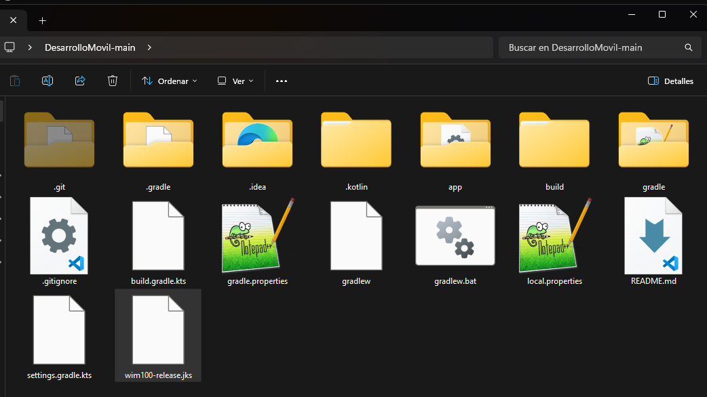
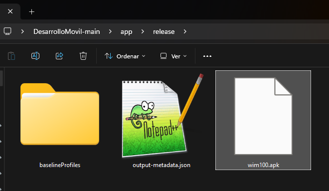

# WIM100 - Plataforma Móvil de Postulación y Evaluación de Candidatas

Aplicación Android desarrollada en **Kotlin** con **Jetpack Compose** y **Material 3** para gestionar el registro, evaluación técnica ponderada y selección de candidatas en el área de ciberseguridad. Integra almacenamiento local con **Room**, consumo de una API REST en **Spring Boot + MySQL** mediante **Retrofit** y consulta a la API externa **RandomUser**.

- **Repositorio Frontend (Android):** https://github.com/DanielEscalanteS/DesarrolloMovil
- **Repositorio Backend (Spring Boot):** https://github.com/BastianHuenchullan/wim100-backend
- **Tablero de planificación (Trello):** https://trello.com/b/LbivxLP3/wim100-desarrollo-y-entrega

---

## 1. Nombre del proyecto

**WIM100 (Women in Cybersecurity - Gestión y Evaluación de Candidaturas)**

---

## 2. Integrantes

| Integrante | Usuario GitHub | Perfil |
| --- | --- | --- |
| Bastian Huenchullan | `BastianHuenchullan` | https://github.com/BastianHuenchullan |
| Daniel Escalante | `DanielEscalanteS` | https://github.com/DanielEscalanteS |
| Johaquín Fernandez | `JojitaGamerHD` | https://github.com/JojitaGamerHD |

---

## 3. Funcionalidades

### Roles y flujos de usuario
- **Postulante (acceso público sin sesión):** Formulario de postulación abierto para registrar datos personales, especialidad en ciberseguridad, años de experiencia, enlace de LinkedIn y currículum en PDF.
- **Evaluadora (`EVALUADORA`):** Inicio de sesión validado contra el backend, consulta y sincronización del listado de postulantes, registro/edición/eliminación de candidaturas no resueltas y evaluación mediante rúbrica ponderada.
- **Dirección (`DIRECCION`):** Acceso protegido con autenticación biométrica o credencial del dispositivo (`BiometricPrompt`), ranking filtrable y ordenable, comparación lado a lado de 2 a 3 candidatas de la misma área, resolución final (`SELECCIONADA` / `NO_SELECCIONADA`) e historial de auditoría.

### Arquitectura, persistencia y recursos nativos
- **Arquitectura MVVM:** Separación en capas `ui`, `viewmodel` (`StateFlow` + corrutinas), `model`, `validation` y `data` (`local`, `remote`, `repository`).
- **Persistencia híbrida:** Base de datos local **Room** (`wim100.db`) sincronizada con el backend **Spring Boot + MySQL** mediante **Retrofit**.
- **Rúbrica ponderada:** 5 criterios (*Trayectoria* 25 %, *Conocimientos* 25 %, *Liderazgo* 20 %, *Visión* 15 %, *Comunicación* 15 %) calificados de 1 a 5 con cálculo automático sobre 100 puntos, justificación obligatoria para notas bajas (1 o 2) y bloqueo de evaluaciones duplicadas.
- **Recursos nativos Android:**
  - Selector de documentos (`OpenDocument`), validación de integridad (`PdfRenderer`, formato `.pdf`, máximo 5 MB), almacenamiento privado y apertura mediante `FileProvider` para el CV.
  - Verificación biométrica / bloqueo de pantalla del dispositivo (`BiometricPrompt`) para el rol Dirección.
- **Pruebas unitarias (>80 % de cobertura en lógica de negocio):** Suite automatizada con **JUnit 4**, **MockK** y **kotlinx-coroutines-test** (`validation` 100 %, `data/remote` 97 %, `model` 93 %, `data/repository` 89 % y `viewmodel` 89 %).

---

## 4. Endpoints utilizados (API externa y microservicio)

### Microservicio Backend (Spring Boot + MySQL)
URL base por defecto en emulador Android: `http://10.0.2.2:8080/api/`

| Método | Endpoint | Descripción | Respuestas |
| --- | --- | --- | --- |
| `POST` | `/api/auth/login` | Autentica credenciales y devuelve usuario y rol (`EVALUADORA` o `DIRECCION`). | `200`, `400`, `401` |
| `GET` | `/api/postulantes` | Obtiene el listado de postulantes ordenado por fecha de registro. | `200` |
| `GET` | `/api/postulantes/{id}` | Obtiene el detalle de una postulante por ID. | `200`, `404` |
| `POST` | `/api/postulantes` | Registra una nueva postulación. | `201`, `400`, `409` |
| `PUT` | `/api/postulantes/{id}` | Actualiza los antecedentes de una postulante existente. | `200`, `400`, `404`, `409` |
| `PATCH` | `/api/postulantes/{id}/estado` | Actualiza el estado (`POSTULADA`, `EN_EVALUACION`, `EVALUADA`, `SELECCIONADA`, `NO_SELECCIONADA`). | `200`, `400`, `404` |
| `DELETE` | `/api/postulantes/{id}` | Elimina una postulación no resuelta. | `204`, `404` |
| `GET` | `/api/evaluaciones` | Lista las evaluaciones registradas junto con sus puntajes por criterio. | `200` |
| `POST` | `/api/evaluaciones` | Registra o actualiza una evaluación y sus puntajes asociados. | `200` |

### API Externa (RandomUser)
| Método | Endpoint | Uso en la aplicación |
| --- | --- | --- |
| `GET` | `https://randomuser.me/api/?gender=female&nat=es&inc=name` | Genera nombres femeninos aleatorios en el formulario de Evaluadora para agilizar pruebas y demostraciones (en caso de fallo de red, permite ingreso manual sin bloquear el formulario). |

---

## 5. Pasos para ejecutar

### Requisitos previos
- **Java:** JDK 17 (para el backend) y JDK 21 (para Gradle en Android).
- **Base de datos:** MySQL 8 ejecutándose en el puerto `3306` con la base de datos `wim100`.
- **IDE:** Android Studio con Android SDK 37 (`minSdk 24`).

### Paso 1: Ejecutar el microservicio backend
1. Clonar el repositorio del backend:
   ```bash
   git clone [https://github.com/BastianHuenchullan/wim100-backend.git](https://github.com/BastianHuenchullan/wim100-backend.git)
   cd wim100-backend
   ```
2. Verificar credenciales de MySQL en `src/main/resources/application.properties` (por defecto `localhost:3306/wim100`, usuario `root`).
3. Iniciar el servidor Spring Boot (puerto `8080`):
   ```bash
   # Windows (PowerShell)
   .\mvnw.cmd spring-boot:run

   # Linux / macOS
   ./mvnw spring-boot:run
   ```

### Paso 2: Ejecutar la aplicación Android
1. Clonar este repositorio y abrir la carpeta raíz en Android Studio:
   ```bash
   git clone [https://github.com/DanielEscalanteS/DesarrolloMovil.git](https://github.com/DanielEscalanteS/DesarrolloMovil.git)
   cd DesarrolloMovil
   ```
2. Verificar la URL del servidor en `app/src/main/java/com/example/wim100/data/remote/RetrofitClient.kt`:
   - **Emulador Android:** `http://10.0.2.2:8080/api/`
   - **Dispositivo físico (misma red Wi-Fi):** `http://<IP_DEL_COMPUTADOR>:8080/api/`
3. Sincronizar Gradle y ejecutar el módulo `app` sobre un emulador o teléfono Android.

### Comandos útiles desde terminal
```bash
# Ejecutar pruebas unitarias
.\gradlew.bat :app:testDebugUnitTest

# Compilar APK debug
.\gradlew.bat :app:assembleDebug

# Compilar APK release
.\gradlew.bat :app:assembleRelease
```

### Cuentas de prueba precargadas
| Usuario | Contraseña | Rol |
| --- | --- | --- |
| `evaluadora1` | `wim2026` | `EVALUADORA` |
| `evaluadora2` | `wim2026` | `EVALUADORA` |
| `direccion` | `wim2026` | `DIRECCION` |

---

## 6. Captura del APK firmado y .jks

### Keystore generado (`wim100-release.jks`)
Por seguridad, la llave de firma `.jks` y sus contraseñas se resguardan localmente y no se suben al repositorio público:



### APK firmado de producción (`app/release/wim100.apk`)

